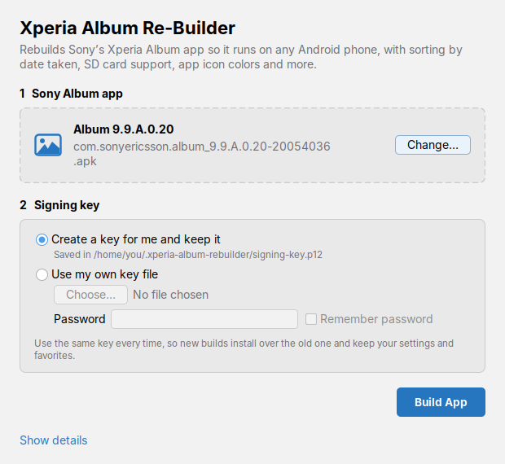
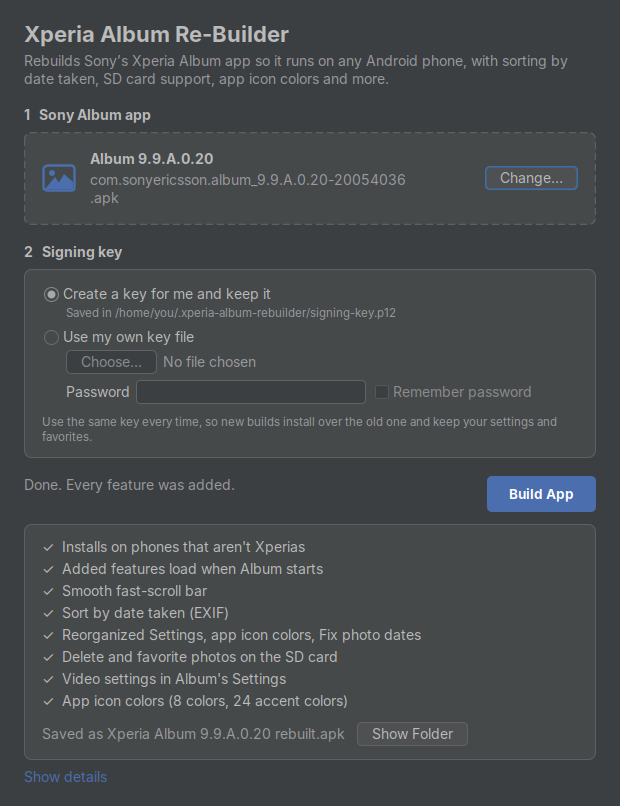

<p align="center"></p>

<h1 align="center">Xperia Album Re-Builder</h1>

<p align="center">Rebuilds Sony’s Xperia Album gallery app so it installs on any Android phone, and adds sorting by date taken, SD card support, app icon colors and a tidier Settings screen.<br>For macOS and Windows.</p>

<p align="center">
  
  
</p>

## What it adds

- **Installs on any phone.** Sony’s app refuses to install on phones that aren’t Xperias. The rebuilt app doesn’t.
- **Smooth fast-scroll bar.** On phones where hiding the navigation bar resizes the screen, Album’s scroll handle let go after a few pixels. The bars now stay visible while you fast-scroll, and the handle follows your finger.
- **Sort by date taken.** Photos are sorted by the date in their EXIF data, so copied or transferred photos appear where they belong even when Android doesn’t know their date taken. A switch in Settings turns it off.
- **Fix photo dates.** Corrects the saved date of those photos, so every app sorts them correctly. The pictures themselves aren’t changed.
- **SD card support.** Delete and favorite photos and videos on an SD card. Sony’s app used Android features that newer versions of Android block, and asked for access to the whole card, which Android no longer allows; the rebuilt app asks for the folder that holds your photos (such as DCIM) instead.
- **App icon colors.** Choose Orange (Sony’s original), Red, Pink, Purple, Blue, Teal, Green or Graphite in Settings. Album restarts in the new color, and its headings, list titles and switches change with it.
- **Tidier Settings.** Four sections: General (Theme, App icon color, Navigation menu), Photo (Header slideshow, Sort by date taken, Fix photo dates), Video (Background playback, Subtitle settings) and About. Settings for Sony-only services are gone.

## Download

Get the latest build from the [Releases](../../releases) page:

| Computer | File |
|---|---|
| Mac with Apple silicon (M1 and later) | `Xperia-Album-Re-Builder-mac-apple-silicon.zip` |
| Mac with an Intel processor | `Xperia-Album-Re-Builder-mac-intel.zip` |
| Windows 10 or 11 | `Xperia-Album-Re-Builder-windows.zip` |

No Java install is needed; everything is included.

**Mac:** unzip and drag the app to Applications. The app isn’t notarised by Apple, so the first time you open it macOS will say it can’t check it. Click Done, open **System Settings → Privacy & Security**, scroll down and click **Open Anyway**.

**Windows:** unzip the folder anywhere and run `Xperia Album Re-Builder.exe`. If SmartScreen appears, click **More info → Run anyway**.

## How to use it

1. **Get Sony’s Album app.** You need its APK (`com.sonyericsson.album`; tested with 9.9.A.0.20), for example copied off an Xperia. The Re-Builder doesn’t include it or download it. If you have a split app, use the `base.apk` inside it.
2. **Drop it on the window**, or click Choose File.
3. **Choose a signing key.** Android only installs an update over an app signed with the same key, so use the same one every time:
   - *Create a key for me and keep it.* The Re-Builder makes one and stores it in its settings folder.
   - *Use my own key file.* Choose a `.jks` or `.p12` file and enter its password. Use the key from an earlier rebuild to update that rebuild without losing your settings and favorites.
4. **Click Build App** and choose where to save. The window lists each feature with ✓, or ✗ and the reason if a future version of Sony’s app has changed too much for it.
5. Copy the APK to your phone and open it to install. If an older rebuild signed with a different key is installed, uninstall it first. Your photos aren’t affected: Album only shows what’s on the phone.

Where the key is kept:

- **Mac:** `~/Library/Application Support/Xperia Album Re-Builder/`
- **Windows:** `%APPDATA%\Xperia Album Re-Builder\`

Back up `signing-key.p12` and `signing-key.password` from there. Without them you can’t update the app later.

### After changing the icon color

Android removes the old icon’s shortcut from the home screen when the color changes. Add Album to the home screen again from the app list.

### Command line

```
"Xperia Album Re-Builder" --cli <sony-album.apk> <output.apk> <key.jks|key.p12> <password>
```

## How it works

The Re-Builder never rebuilds Sony’s resources. It:

1. unpacks only the app’s code with Apktool,
2. finds the right places in Sony’s code by what they do rather than by fixed line numbers, so newer versions of the app should keep working, and adds calls into the new code,
3. rebuilds only the code files it changed, and adds the new features as an extra code file (`payload.dex`, built from [`payload/src`](payload/src)),
4. edits the binary manifest and resource table directly: it marks Sony’s device library optional, adds the recolored icons (made from your copy’s own icon) and one launcher entry per icon color,
5. puts everything back into a copy of the original APK, aligns it, and signs it with your key (APK signature schemes v1, v2 and v3).

## Building from source

Pushing to `main` builds the Mac and Windows apps with GitHub Actions ([`.github/workflows/build.yml`](.github/workflows/build.yml)). Pushing a tag such as `v1.0.0` also publishes them as a release.

To run from source on your own computer (JDK 17 or newer):

```
scripts/run-local.sh
```

To change the code that runs inside the Album app, edit `payload/src`, then run `scripts/build-payload.sh` (needs Android build-tools for `d8`).

## Credits and licences

The Re-Builder is MIT-licensed. The release builds include Apktool, uber-apk-signer and FlatLaf (all Apache 2.0). See [NOTICE](NOTICE) for details.

This project contains nothing of Sony’s and isn’t affiliated with or endorsed by Sony. Xperia is a trademark of Sony Group Corporation.
